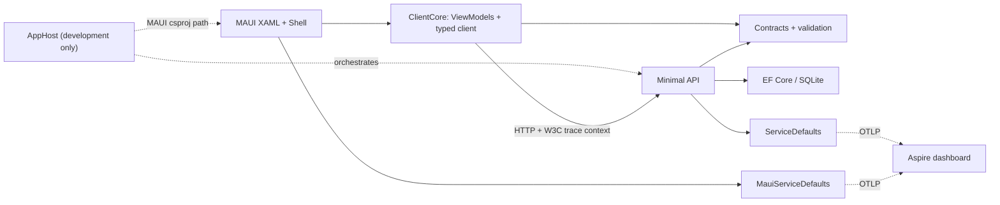

# Architecture

TaskBoard deliberately keeps one backend and one native client. It has no Docker, cloud services, authentication, cache, or message broker.

## Dependency direction

The AppHost references the API as a project and generates the `Projects.TaskBoard_Api` type. It registers MAUI using its project path, never a project reference. Neither Contracts nor ClientCore references Aspire hosting or MAUI.

## Native presentation and MVVM

`TasksViewModel` owns an observable task collection, refresh/completion/deletion commands, errors, and the last successful synchronization time. Failed refreshes retain the previous collection and timestamp. Tasks use immutable DTO snapshots; successful updates replace the corresponding item.

`TaskEditorViewModel` uses shared validation limits, creates or updates through `ITaskApiClient`, and closes only after success. Save is disabled for invalid input. Cancel aborts an in-flight request. Closing is serialized: concurrent Save/Cancel actions cannot pop two pages. If navigation fails after a successful create, the editor retains the returned ID so another Save updates that task. A canceled write may already have reached the server; refresh before trying again.

`DiagnosticsViewModel` measures end-to-end request duration, including retry delays. Native connectivity is exposed through `IConnectionStatus`. The indicator is a network signal, not a backend health probe.

CommunityToolkit.Mvvm generates observable properties and async commands. `OperationViewModel` catches faults at awaited UI operation boundaries, including HTTP requests, navigation, and deletion confirmation. Caller cancellation ends quietly; timeouts, malformed API responses, open circuits, and rate limiting receive localized messages. Unexpected exceptions receive a generic message with their details logged at Error level; expected request failures are logged at Warning level. Busy/refresh state resets so the user can retry. Page dispatch and native connectivity callbacks use the same guarded boundary. Navigation and deletion confirmation use `ITaskNavigationService`; test doubles require no UI platform.

Startup catches configuration, dependency resolution, telemetry initialization, and initial XAML failures. A minimal native error page replaces the regular shell when initialization fails; its details go to console/debug logs. For MAUI 10.0.110's duplicate normalized environment keys, matching ASPNETCORE_ entries are temporarily excluded while building, preferring DOTNET_ entries, and restored afterward. Runtime UI failures are handled where they occur rather than marking process-wide unhandled exceptions as handled.

Pages contain compiled bindings, CollectionView, RefreshView, an editor, and diagnostics controls. Code-behind handles page lifecycle, native connectivity events, and Shell query forwarding. ViewModels contain no concrete MAUI types. Layout width is capped on desktop; wrapping actions and scrollable forms accommodate narrow displays. Theme bindings follow system light/dark appearance. Resources in ClientCore supply English fallback and German satellite translations using device UI culture.

## HTTP contracts and status codes

| Operation | Success | Failure |
| --- | --- | --- |
| GET /api/tasks | 200, ordered task snapshots | 500 Problem Details on unexpected failure |
| GET /api/tasks/{id} | 200 | 404 Problem Details |
| POST /api/tasks | 201 and Location | 400 validation Problem Details |
| PUT /api/tasks/{id} | 200, updated snapshot | 400 validation / 404 |
| DELETE /api/tasks/{id} | 204 | 404 |
| Development GET /api/demo/slow | 200 | 400 for delay outside 0–10000 ms |
| Development GET /api/demo/fail | — | 503 Problem Details |

Blank titles are rejected; titles are trimmed and limited to 120 characters. Descriptions are optional and limited to 2000 characters. Empty descriptions normalize to null. Creates can set completion; updates preserve creation time and refresh the UTC modification timestamp. Invalid GUID routes return 404. Malformed JSON is handled by ASP.NET Core binding and Problem Details middleware.

The typed client sends relative routes and passes cancellation tokens to every HTTP and deserialization operation. It disposes responses, parses Problem Details, and retains HTTP status codes for proxy responses that do not contain JSON or have malformed validation entries. Null or invalid successful task payloads are rejected before replacing the board's existing collection. It does not log request bodies or task descriptions. The API's exception middleware returns HTTP 500 Problem Details for unexpected request failures without exposing exception details, while keeping the host available for subsequent requests.

## Discovery and standalone configuration

The MAUI startup checks whether `services:taskapi` has endpoints. If present, the client uses `https+http://taskapi`; service discovery selects the supplied HTTPS or HTTP endpoint. Otherwise it validates the conventional URL from embedded `clientsettings.json` and environment configuration.

The same API interface, DTOs, ViewModels, and resilience policy operate in both modes. Aspire contributes endpoint and OTLP configuration at native launch. A client started independently cannot assume it inherited the AppHost's configuration.

Desktop targets connect directly to host endpoints. Development registers Android and host-supported iOS simulator targets by default. They reference an API Dev Tunnel and an OTLP tunnel, both stopped until a mobile resource is started. The shared starter serializes mobile starts, reuses running tunnels, and waits for their health/readiness before deployment. Host OS checks register only supported desktop/Apple targets. No public tunnel is opened during default desktop startup; the optional mobile preparation profile starts tunnels earlier.

## Telemetry and resilience

Backend defaults adapt the official Aspire Service Defaults template. They register HTTP/service discovery, structured OpenTelemetry logging, ASP.NET Core/HTTP instrumentation, process metrics, and Development `/health` and `/alive` endpoints. Readiness includes a database connectivity check.

MAUI defaults adapt the workload's official template. An `IMauiInitializeService` resolves telemetry providers because native startup does not start an ordinary web host. OTLP exporters are enabled only when an endpoint is configured. HttpClient instrumentation and ASP.NET Core instrumentation propagate W3C trace context, creating a client/server trace without custom headers.

Backend outbound clients receive a standard resilience handler with unsafe-method retries disabled. Native defaults register discovery globally; the task client adds one explicit standard resilience pipeline. This keeps client policy in the platform-independent code and prevents stacked handlers.

The task client's policy is:

- GET: up to two retries for transient failures, constant 500 ms delay, no jitter.
- POST, PUT, PATCH, DELETE: zero automatic retries, including timeouts.
- Attempt timeout: 3 seconds; total request timeout: 12 seconds.
- HttpClient also limits the full HTTP exchange to 12 seconds, including response-body buffering outside the resilience handler's timeout scope.
- Standard circuit breaker and rate limiter remain enabled.

There is no offline queue. Unknown write outcomes are reconciled by refreshing rather than automatically resending writes. Changing limits is centralized in `ClientServiceCollectionExtensions`; tests execute the actual pipeline.

## SQLite lifecycle

The API constructs a default database path relative to its content root, or uses `ConnectionStrings:taskboard`. It creates the parent directory only for the default path. EF Core `EnsureCreatedAsync` initializes the tutorial schema and model seed data. Outside Development, newly created seed rows are removed. Seeds are inserted once during schema creation, so deleting all tasks never reseeds an existing database.

SQLite stores date/time values without timezone metadata. EF converters restore `DateTimeKind.Utc` on reads so API timestamps keep their UTC meaning. Reads use no tracking; cancellation reaches EF operations and demo delays.

This sample uses schema creation rather than migrations. After changing the model, delete the disposable local database and restart, or introduce migrations before supporting durable schema upgrades. It assumes a single local API process; concurrent writers use SQLite's locking, and multi-instance initialization is outside its tutorial scope. A PUT follows last-write-wins behavior; no ETags or conflict resolution are supplied.

## Tests and boundaries

Client tests use simple API/navigation doubles and real resilience handlers with controlled HTTP responses. API tests start the actual Minimal API with WebApplicationFactory and unique temporary SQLite files. Database pooling is disabled for those files; factories delete their own database after disposal.

Tests never share the developer database, launch Aspire, or start emulators. Native packaging, XAML runtime interaction, device networking, tunnel authentication, and dashboard telemetry require the manual platform checks.
